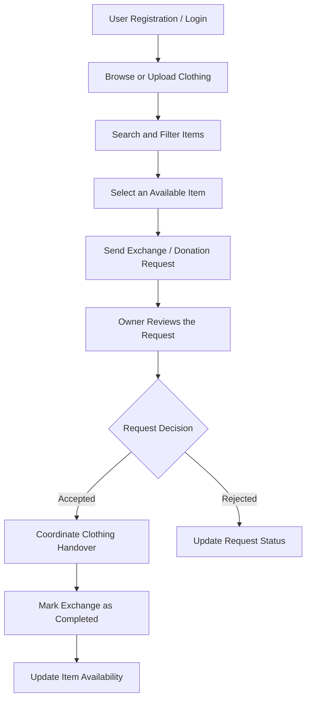

# ReWear – A Community-Based Clothing Exchange and Reuse Platform

**ReWear** is a web-based platform designed to promote sustainable fashion by enabling users to exchange, donate, and reuse pre-owned clothing. It connects individuals who want to give away or exchange clothing through a centralized digital platform, helping reduce textile waste and encourage responsible consumption.

---

## Team Members

| S. No. | University ID | Name |
|:---:|:---:|---|
| 1 | 2420030400 | Masuma Fathema |
| 2 | 2420030568 | Avinash Yarukala |
| 3 | 2420030287 | Gorantla Divya Sree |

**Supervisor:** Ms. G. Lavanya

---

## Abstract

ReWear is a web-based platform designed to promote sustainable fashion by enabling users to exchange, donate, and reuse pre-owned clothing. The increasing consumption of clothing contributes to textile waste, while many usable garments remain unused or are discarded. ReWear addresses this problem by connecting individuals who want to give away or exchange clothing through a centralized digital platform.

Users can register, upload clothing listings with images and details such as category, size, condition, and availability, and browse items shared by other users. The platform provides search and filtering capabilities to help users find suitable clothing and an exchange request mechanism to manage requests, approvals, and transaction status. An administrative dashboard enables the management of listings, reported content, and user activity.

By encouraging clothing reuse and community participation, ReWear aims to reduce textile waste, improve access to affordable clothing, and promote responsible consumption. The platform demonstrates the practical application of web development, database management, user authentication, and digital marketplace technologies while supporting environmental sustainability.

---

## Objectives

- Develop a centralized platform for clothing exchange, donation, and reuse.
- Enable users to create, manage, search, and filter clothing listings.
- Implement an exchange request system to facilitate interactions between users.
- Provide secure user authentication and manage clothing availability and request status.
- Develop an administrative dashboard to manage listings, reports, and user activity.
- Encourage sustainable fashion practices and reduce unnecessary textile waste.

---

## Technologies Used

| Component | Technology |
|---|---|
| Frontend | HTML5, CSS3, JavaScript |
| Backend | Python Flask |
| Database | MySQL |
| Image Management | Local image uploads during development |
| APIs and Integration | Flask routes and REST endpoints |
| Code Editor | Visual Studio Code |
| Version Control | Git |
| Repository Hosting | GitHub |
| Deployment | Render |

---

## Key Features

### 1. User Registration and Login
Allows users to create accounts and securely access the platform.

### 2. Clothing Listings
Enables users to upload clothing images and provide item details, including category, size, condition, and description.

### 3. Search and Filtering
Helps users discover clothing based on size, category, condition, and availability.

### 4. Exchange Requests
Allows users to request available items or propose clothing exchanges.

### 5. Request Management
Enables users to accept, reject, and track exchange requests.

### 6. Donation Option
Allows users to list clothing items that are available to others at no cost.

### 7. User Dashboard
Displays uploaded items, received requests, sent requests, and their current statuses.

### 8. Admin Dashboard
Enables administrators to manage users, review listings, and handle reported content.

### 9. Clothing Availability Tracking
Updates item availability when an exchange or donation is completed.

### 10. Sustainability Awareness
Encourages the reuse of clothing and responsible consumption.

---

## System Workflow

The following workflow describes the planned process for clothing exchange and donation.



---

## Expected Outcome

ReWear provides a simple and accessible platform for connecting people who want to exchange or donate pre-owned clothing. It simplifies clothing discovery and request management while encouraging reuse, reducing avoidable textile waste, and promoting sustainable fashion within the community.

---

## Project Structure

```text
ReWear/
├── backend/
│   ├── app.py
│   ├── routes/
│   ├── models/
│   └── requirements.txt
├── frontend/
│   ├── templates/
│   └── static/
│       ├── css/
│       ├── js/
│       └── uploads/
├── data/
│   └── schema.sql
├── docs/
│   ├── architecture/
│   ├── design/
│   └── requirements/
├── reports/
├── results/
├── tests/
├── .gitignore
└── README.md
```

*Note: This is a suggested project structure. Update it to match the files and folders actually present in your repository.*

---

## Development Setup

### Prerequisites

- Python 3.x
- MySQL Server
- Visual Studio Code
- Git

### Installation

1. Clone the repository:

   ```bash
   git clone <your-github-repository-url>
   ```

2. Navigate to the project directory:

   ```bash
   cd ReWear
   ```

3. Create and activate a virtual environment:

   ```bash
   python -m venv venv
   ```

   On Windows:

   ```bash
   venv\Scripts\activate
   ```

   On Linux or macOS:

   ```bash
   source venv/bin/activate
   ```

4. Install the required Python dependencies:

   ```bash
   pip install -r backend/requirements.txt
   ```

5. Configure the MySQL database and the required environment variables according to your application configuration.

6. Run the Flask application using the appropriate entry point for your project.

   For example, if your Flask entry point is `backend/app.py`:

   ```bash
   python backend/app.py
   ```

---

## Future Enhancements

- Add notifications for exchange request updates.
- Improve clothing discovery with additional filters.
- Enhance the administrative dashboard and reporting features.
- Introduce persistent image storage for production deployment.
- Improve accessibility and mobile responsiveness.

---

## Sustainability Impact

ReWear supports more responsible clothing consumption by encouraging people to reuse garments rather than discard them. By facilitating clothing exchange and donation within a community, the platform aims to contribute to waste reduction and more sustainable fashion practices.

---

## License

This project is developed for academic purposes as part of the Adaptive Software Engineering course. A formal open-source license can be added if required.
